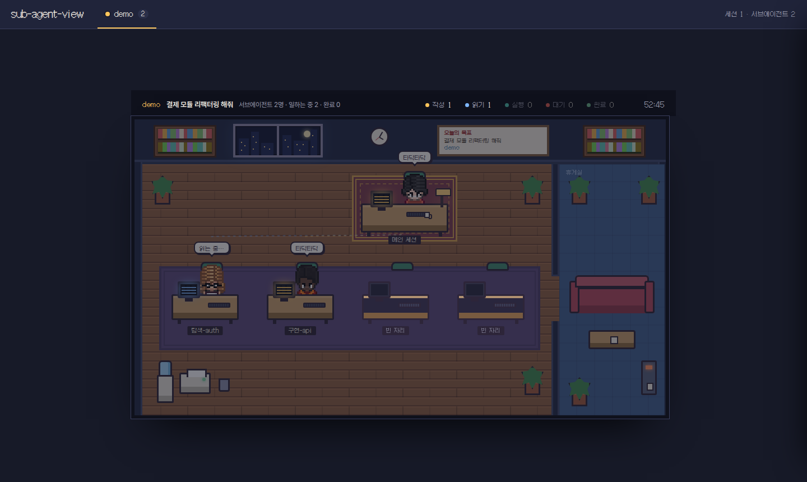

# sub-agent-view

Claude Code 세션이 띄운 서브에이전트들을 픽셀 사무실의 캐릭터로 보여주는 로컬 대시보드입니다. 캐릭터를 클릭하면 지금 무엇을 하는지, "상세히"를 누르면 그 서브에이전트의 터미널(트랜스크립트)이 보입니다. 세션마다 사무실이 하나씩이고 상단 탭으로 오갑니다.



## 설치와 실행

Node 20 이상만 있으면 됩니다. 외부 패키지 설치는 없습니다.

```bash
git clone <this-repo> sub-agent-view && cd sub-agent-view
node server/index.js --install-hooks     # ~/.claude/settings.json 에 전달 훅 9개 추가 (Claude Code 재시작 후 적용)
node server/index.js                     # http://127.0.0.1:4711
```

브라우저에서 `http://127.0.0.1:4711`을 엽니다. 훅을 설치하지 않아도 `~/.claude/projects`의 트랜스크립트만으로 동작하지만, 훅이 있으면 상태 전이와 허가 요청이 즉시 반영됩니다.

- 훅 제거: `node server/index.js --uninstall-hooks`
- 포트 변경: `SAV_PORT=5000 node server/index.js` 또는 `--port 5000`
- 다른 트랜스크립트 폴더 보기: `--root /path/to/projects`
- 상태 확인: `curl http://127.0.0.1:4711/api/health`

## 플러그인으로 설치 (settings.json 수정 없이)

이 저장소는 Claude Code 플러그인이자 마켓플레이스입니다. 플러그인을 켜면 훅이 자동으로 병합되어 `--install-hooks`가 필요 없습니다.

```
/plugin marketplace add <github-owner>/sub-agent-view
/plugin install sub-agent-view@sub-agent-view
/sub-agent-view:office        # 서버를 띄우고 주소를 안내
```

업데이트는 `/plugin marketplace update sub-agent-view` 뒤 `/reload-plugins`. 플러그인 훅은 포트 4711로 고정입니다.

## 데이터는 어디로 가나

아무 데도 가지 않습니다. 서버는 `127.0.0.1`에만 바인딩되고, 훅은 로컬 서버로만 보내며(`curl -m 1 … || true`, 비동기), 서버가 꺼져 있어도 Claude Code는 영향을 받지 않습니다. 프롬프트와 도구 입력은 메모리에만 두고 로그에 쓰지 않습니다.

## 어떻게 동작하나

- `~/.claude/projects/<프로젝트>/<세션>.jsonl`과 `<세션>/subagents/agent-*.jsonl`을 tail 해 도구 호출·결과·토큰을 읽습니다.
- Claude Code 훅(SessionStart/End, UserPromptSubmit, PreToolUse, PostToolUse, PermissionRequest, SubagentStart/Stop, Stop)이 `POST /hook`으로 이벤트를 보냅니다.
- 브라우저는 `/events`(SSE)로 스냅샷과 변경분을 받습니다.
- 상태: 코드 작성 중 · 읽는 중 · 명령 실행 중 · 허가 대기 · 완료(10분 뒤 퇴근) · 메인 세션의 분배 중/입력 대기.

## 개발

```bash
npm test                 # node:test
bash scripts/smoke.sh    # 픽스처 세션으로 서버를 띄워 스냅샷 확인
```

설계 문서는 `docs/superpowers/specs/`, 구현 계획은 `docs/superpowers/plans/`에 있습니다.

## 출처

- 캐릭터: JIK-A-4의 [Metro City](https://jik-a-4.itch.io/metrocity-free-topdown-character-pack) 팩(CC0). 시트 구성은 [pixel-agents](https://github.com/pablodelucca/pixel-agents)(MIT)와 같습니다. `web/assets/characters/CREDITS.md`
- 폰트: Galmuri11, Pretendard (모두 OFL 1.1). `web/fonts/LICENSE.md`
- 사무실 구성 아이디어: pixel-agents, [claude-office](https://github.com/paulrobello/claude-office), [agents-in-the-office](https://github.com/gukosowa/agents-in-the-office)
